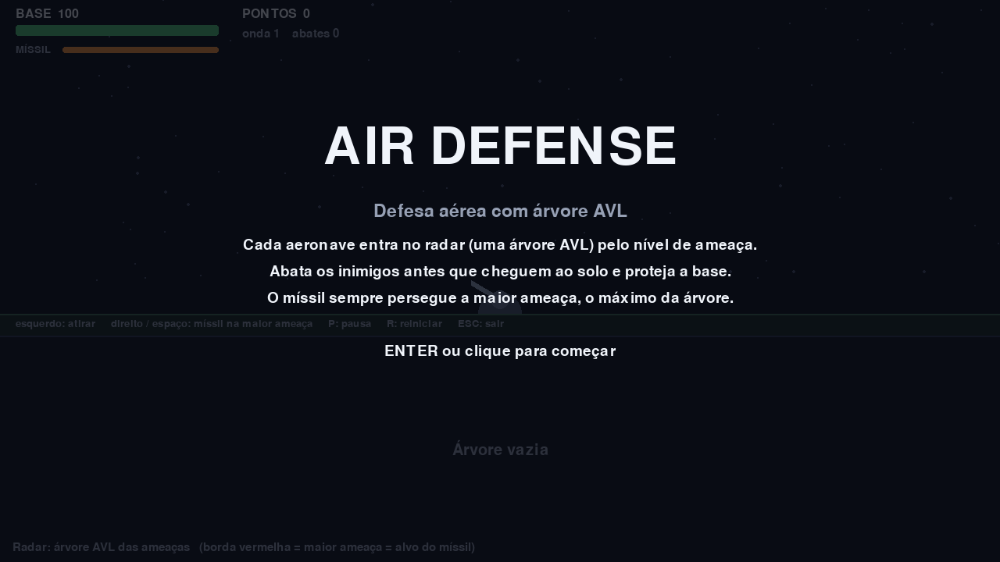
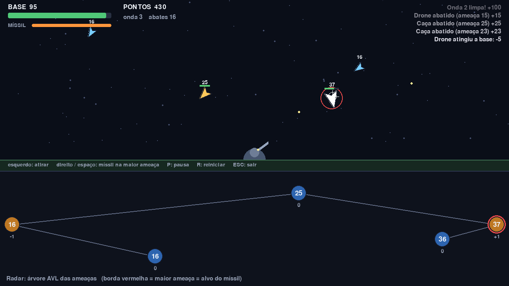
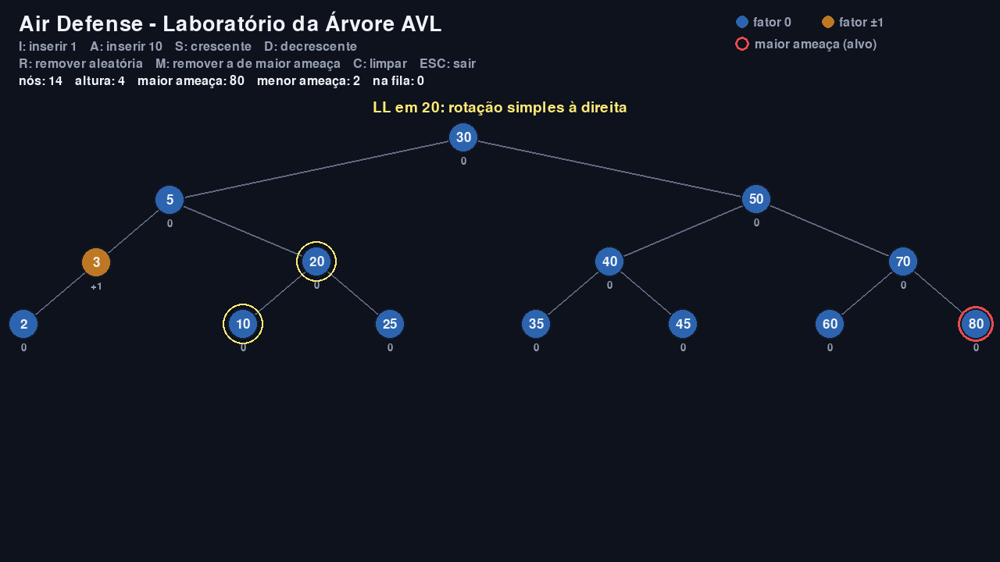

# ✈️ Air Defense - Defesa Aérea com Árvore AVL
 
<p align="center">
  
  
  
  
</p>

## 📝 Descrição
 
O Air Defense é um jogo de defesa aérea desenvolvido em Python com Pygame. O jogador controla uma bateria antiaérea que precisa neutralizar ondas de aeronaves inimigas antes que elas alcancem a base. Todo o controle dos alvos ativos é feito por uma **Árvore AVL implementada manualmente**, sem uso de bibliotecas prontas de árvores.
 
O projeto resolve um problema real de sistemas de defesa e monitoramento: manter dezenas de alvos em movimento organizados por nível de ameaça, permitindo inserir novos alvos, remover os destruídos e consultar o mais perigoso de forma eficiente, mesmo com o número de alvos variando a todo instante.
 
## 💡 Diferenciais Técnicos
 
O principal destaque do projeto é a ligação direta entre a mecânica do jogo e as operações da árvore, de modo que cada ação do jogo é uma operação de estrutura de dados:
 
- **Árvore AVL manual:** armazena os inimigos ativos ordenados por nível de ameaça, com altura sempre $O(\log n)$;
- **Rotações visíveis:** as rotações simples e duplas (LL, RR, LR, RL) são desenhadas na tela, mostrando o rebalanceamento em tempo real;
- **Visualização da árvore:** painel lateral com a árvore desenhada nó a nó, exibindo o fator de balanceamento de cada um;
- **Interface Pygame:** janela com sprites, mira, ondas de inimigos e HUD de pontuação e vida da base.
Essas abordagens tornam o comportamento da árvore visível e demonstram na prática os conceitos de árvores balanceadas estudados na disciplina.
 
## 🌳 Estruturas e Algoritmos Implementados
 
### ➕ Inserção na AVL
 
Cada aeronave que entra no radar é inserida na árvore pelo seu nível de ameaça (com o ID como critério de desempate). Após a inserção, os fatores de balanceamento são recalculados no caminho de volta e as rotações necessárias são aplicadas, com custo $O(\log n)$.
 
### ➖ Remoção na AVL
 
Quando um inimigo é abatido, ele é removido da árvore. Os três casos de remoção (nó folha, um filho e dois filhos, usando o sucessor em ordem) são tratados, seguidos do rebalanceamento, também em $O(\log n)$.
 
### 🔎 Busca e Consulta de Extremos
 
A busca localiza um inimigo específico pelo seu identificador de ameaça. A consulta do **máximo** (alvo mais perigoso) e do **mínimo** (alvo menos perigoso) percorre apenas um ramo da árvore, em $O(\log n)$.
 
### 🔄 Rotações e Balanceamento
 
Implementação manual das rotações simples à esquerda e à direita e das rotações duplas, mantendo a diferença de altura entre as subárvores de cada nó em no máximo 1.
 
### 📋 Percurso em Ordem
 
Utilizado para listar todos os alvos do radar ordenados por ameaça, com complexidade $O(n)$.
 
## 🛠️ Tecnologias Utilizadas
 
- **Linguagem Python 3**
- **Pygame** para janela, desenho, eventos e loop do jogo
- **Árvore AVL implementada à mão** (nós, ponteiros, alturas e rotações)
- **Git/GitHub** com commits graduais
## ⚙️ Como Executar
 
### Pré-requisito
 
Certifique-se de que o Python 3.10 ou superior está instalado e disponível no `PATH` do terminal.
 
### Passo a passo
 
1. Clone o repositório:
```bash
git clone https://github.com/eda2-2026/G41_Arvore_EDA2-2026.2.git
```
 
2. Acesse a pasta do projeto:
```bash
cd G41_Arvore_EDA2-2026.2
```
 
3. Instale a dependência:
```bash
pip install pygame
```
 
4. Execute o jogo:
```bash
python jogo.py
```
 
## 🎮 Como Jogar
 
- Mova a mira com o **mouse** e dispare com o **clique esquerdo**;
- Use o **botão direito** ou a tecla **Espaço** para lançar um míssil;
- Pressione **P** para pausar, **R** para reiniciar e **Esc** para sair;
- O alvo mais perigoso (máximo da AVL) fica destacado no radar;
- Destruir um inimigo o remove da árvore e rebalanceia a estrutura;
- Se um inimigo alcançar a base, ela perde vida; o jogo termina quando a vida chega a zero.
 
## 🧪 Funcionalidades do Sistema
 
- Inserção de inimigos na AVL ao entrarem no radar;
- Remoção de inimigos abatidos com rebalanceamento;
- Busca de inimigo por identificador de ameaça;
- Consulta do alvo mais e menos perigoso;
- Rotações simples e duplas com destaque visual;
- Painel com a árvore desenhada e fator de balanceamento por nó;
- Ondas de dificuldade crescente, pontuação e vida da base;
- Testes da árvore independentes da interface.
## 🖼️ Prints do Jogo

### Tela Inicial
<p align="center">
    
</p>

### Partida em Andamento
<p align="center">
    
</p>

### Árvore AVL em Tempo Real
<p align="center">
    
</p>
 
## 📝 Política de Commits (Conventional Commits)
 
O repositório segue um histórico de **commits graduais obrigatórios**, registrando cada etapa do desenvolvimento de maneira clara e rastreável. As implementações, correções e documentação devem ser organizadas em commits pequenos e objetivos.
 
As mensagens devem utilizar as seguintes tags padronizadas:
 
- `feat:` novas implementações;
- `fix:` correções de bugs e ajustes de comportamento;
- `docs:` atualizações no README ou comentários;
- `refactor:` melhorias estruturais sem alterar a funcionalidade.
Exemplos:
 
```text
feat: implementa insercao na arvore AVL
feat: adiciona rotacoes simples e duplas
fix: corrige atualizacao de altura apos remocao
docs: atualiza instrucoes de execucao
refactor: separa logica da arvore da interface do jogo
```
 
## 👤 Autores
 
<p align="center">
    
</p>

- **Nome:** Bernardo Watanabe Venzi
- **Matrícula:** 232001120
- **Modalidade:** dupla

## 🎓 Contexto Acadêmico
 
Trabalho da disciplina de **Estruturas de Dados 2**, turma 2026.2, referente ao Módulo 3 (Árvores).
 